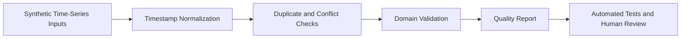

# QuantEdge — Data Engineering Showcase

[](https://github.com/TheMan10101/quantedge-engineering-showcase/actions/workflows/python-tests.yml)

**Public, independently runnable demonstration of time-series data-quality engineering.** The complete QuantEdge research system remains private.

QuantEdge is my independent Python-based market-data research project. In that larger private project, I directed and reviewed AI-assisted development of workflows to process and analyze **more than 250,000 historical five-minute Bitcoin futures observations**, with attention to input quality, reproducible analysis, reporting, and documented limits. **That historical dataset and private system are not in this repository.**

The public code here is an original, synthetic demonstration of transferable engineering techniques. Its artificial observations do not represent trades, market signals, performance, financial advice, or a machine-learning model.

## What you can actually run here

| Public artifact | What it demonstrates |
| --- | --- |
| [`demo_time_series.py`](demo_time_series.py) | Data-quality reporting: missing timestamps, duplicates, conflicting duplicates, invalid values, time-zone normalization, configurable value ranges |
| [`demo_pandas.py`](demo_pandas.py) | A second, independent pandas view of the synthetic dataset, including row-level quality flags |
| [`test_demo_time_series.py`](test_demo_time_series.py) | Standard-library unit tests including edge cases and fail-closed behavior for conflicting data |
| [`test_demo_pandas.py`](test_demo_pandas.py) | pytest tests covering the pandas demonstration |
| [GitHub Actions workflow](.github/workflows/python-tests.yml) | Automated execution of the demonstrations and test suites on changes |

### Quick start

Python 3.12 or newer is recommended. From the repository root:

```bash
# Standard-library demonstration; no installation needed
python demo_time_series.py
python -m unittest discover -v

# Optional pandas example and pytest
python -m pip install -r requirements-demo.txt
python demo_pandas.py
python -m pytest -q

# Scale check: 250,000 NEWLY GENERATED synthetic records
python demo_time_series.py --benchmark 250000
```

The benchmark validates 250,000 newly generated synthetic records, not the private historical dataset. It runs validation twice: first to measure execution time without memory tracing, and then to measure Python-traced allocations during a separate validation pass. Input generation is excluded from timing and tracing. The reported memory is **not total process memory**. Results vary by machine and are **not a production-performance guarantee**.

### Example output

Running `python demo_time_series.py` produces:

```json
{
  "received_records": 12,
  "valid_records": 9,
  "duplicate_records": 1,
  "exact_duplicate_records": 1,
  "conflicting_duplicate_records": 0,
  "conflicting_timestamps": 0,
  "missing_intervals": 1,
  "missing_values": 1,
  "invalid_values": 1,
  "outside_window": 0,
  "mean_valid_value": 104.78
}
```

The separate `demo_pandas.py` classifies two rows as participating in an exact duplicate, one as missing, and one as negative. These are **different diagnostics**, not results from the private research system.

## Engineering decisions demonstrated in the public example

1. **Quarantine conflicting timestamps.** An exact timestamp/value repeat is counted as a duplicate. If values disagree at the same timestamp, the timestamp is flagged and **excluded from valid statistics** instead of quietly accepting the first value. Dedicated tests check this behavior.
2. **Do not mutate raw observations.** `Reading` is a frozen dataclass; validation produces a report rather than editing the source collection.
3. **Normalize time zones before comparing intervals.** The validator requires time-zone-aware timestamps and treats equivalent UTC instants consistently.
4. **Do not impose a single value domain on every sensor.** `min_valid=0.0` rejects negatives by default; `min_valid=None` allows signed accelerometer-like measurements. Invalid/nonfinite values remain excluded.
5. **Keep observations, assumptions, and results separable.** Missing intervals, empty readings, invalid values, and conflicting duplicates are separate findings.

These design choices describe **this public demonstration**. They are not claims that the proprietary QuantEdge implementation uses identical algorithms or thresholds.

## Conceptual workflow



## My role and scope

I direct the requirements, evaluation criteria, and review of AI-assisted engineering work on my independent projects. For this public showcase, the focus is on specific, inspectable choices: preserving raw data, rejecting silent duplicate conflicts, parameterizing value limits, testing adverse inputs, and reporting exactly what was validated. I use **Claude Code and OpenAI Codex in my daily development workflow**, with human review and execution of tests before accepting changes.

### Public demonstration vs. private project

- **Directly observable here:** Python standard library, pandas, pytest, unittest, GitHub Actions, synthetic test data, and a reproducible scale exercise.
- **Broader private-project work (not verified by this repository):** historical market-data research, Streamlit dashboards, Excel/CSV reporting, additional validation and governance processes. The actual pipelines, datasets, and outcomes are not public.
- **Not demonstrated or claimed here:** a trained ML model, predictive accuracy, a deployable trading strategy, a proprietary signal, or 250,000 real data records in this GitHub repository.

## Limitations

This example assumes regularly spaced samples, modest in-memory data, and batch analysis. It does not provide multi-source reconciliation, streaming ingestion, production security controls, participant-level ML validation, or a statistical claim about a financial strategy. pandas may treat `None` and `NaN` as missing in the simplified example; source-system-specific missingness distinctions require additional schema and provenance rules.

## Confidentiality

Only independent demonstration code and invented records belong in this repository. No live account information, API keys, wallets, proprietary models, strategy logic, real trading logs, internal infrastructure, or private datasets are included.
